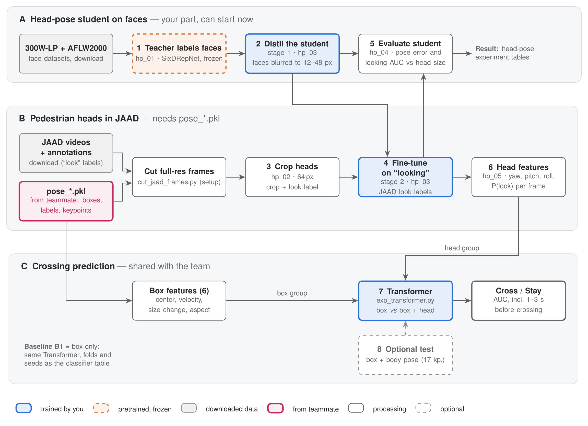

# Early Pedestrian Crossing Prediction with Box Motion and Head Pose

18-794 course project, Carnegie Mellon University.

Will a pedestrian at the curb cross the street? An automated vehicle needs to know **1–2 seconds before** they step out. This project predicts crossing intention on the [JAAD](https://github.com/ykotseruba/JAAD) dataset from two cues:

- **Box motion:** where the pedestrian is and how their bounding box moves.
- **Head pose:** which way the pedestrian is facing, and whether they are looking at the car.

Pedestrian heads in dashcam video are often only 10–30 pixels tall. A large pretrained head-pose model fails at that size, so we **distil it into a small student network trained from scratch for tiny, blurry heads**, then feed the student's output into a Transformer next to the box features.



---

## Results

### 1. Head pose on small heads (AFLW2000, real faces)

Mean angle error in degrees (pitch, yaw, roll averaged). Faces are shrunk to each size, then blurred and compressed like dashcam footage.

| Head size | Teacher (SixDRepNet, 26.8 M params) | **Student (ours, 1.1 M params)** |
|---|---|---|
| Clean, large | **4.5** | 15.8 |
| 48 px | 10.6 | **9.5** |
| 32 px | 18.3 | **9.8** |
| 24 px | 26.6 | **10.3** |
| 16 px | 43.4 | **11.9** |
| 12 px | 52.3 | **13.8** |

The teacher wins on large, clear faces. From 48 px down, which is the size range of pedestrians in dashcam video, the student is better, and almost 4× better at 12–16 px.

### 2. "Is the pedestrian looking at the car?" (JAAD test split)

AUC against JAAD's per-frame `look` labels (0.5 = guessing):

| Head size in the frame | Teacher (yaw rule) | **Student (looking output)** |
|---|---|---|
| 8–16 px | 0.47 | **0.71** |
| 16–32 px | 0.58 | **0.82** |
| ≥ 32 px | 0.77 | **0.93** |
| **All (3,825 heads)** | 0.65 | **0.87** |

### 3. Crossing prediction: box vs box + head

Transformer, 5-fold cross-validation grouped by video, 3 seeds (mean ± std):

| Setting | Box only | Box + head |
|---|---|---|
| All frames, AUC | **0.870** ± 0.033 | 0.860 ± 0.037 |
| Before the decision point, AUC | **0.860** ± 0.115 | 0.819 ± 0.117 |
| Before the decision point, balanced accuracy | **0.738** | 0.692 |

**Finding:** on JAAD, adding head pose does **not** improve early crossing prediction over box motion, even though the head-pose student itself works well. Likely reasons:

- **Too little data:** each test fold has only 3–9 pedestrians who do *not* cross before the decision point, so extra inputs are easy to overfit.
- **Missing heads:** a usable head is visible in only about 70% of frames.
- **Looking may not separate the classes:** pedestrians who wait at the curb also look at traffic.

---

## How it works

### Head-pose student (distillation)

1. **Teacher labels:** the frozen [SixDRepNet](https://github.com/Shohruh72/SixDRepNet) (RepVGG-A2) predicts the head rotation for every face in 300W-LP (122,415 faces).
2. **Degrade:** each clean face is shrunk to 12–48 px (20% of the time up to 80 px), blurred, motion-blurred, darkened or brightened, and JPEG-compressed to look like a JAAD head. It is also randomly zoomed and shifted.
3. **Stage 1, distil:** a MobileNetV3-Small, randomly initialised, learns to predict the teacher's rotation on the clean face from the degraded face (geodesic loss on rotation matrices, 6D rotation output). Large JAAD heads labelled by the teacher are mixed in, so the student also sees real street footage. The best epoch is chosen on held-out 300W-LP *identities*, keeping AFLW2000 as an untouched test set.
4. **Stage 2, looking:** the student is fine-tuned on JAAD train-split `look` labels, with a second output, P(looking).
5. **Per-frame features:** yaw, pitch, roll, P(looking), yaw change, and a "head usable" flag.

Pedestrian heads are located from the nose, eye and ear keypoints already extracted by YOLO26-pose. The keypoints only place the head crop; they are **not** model inputs.

### Crossing model

The Transformer from the classifier comparison (`exp_classifiers.py`): 64-d tokens, 2 encoder layers, 4 heads, mean pooling, over windows of 10 frames sampled every 5 frames.

Each cue group (box, head) has its own linear input projection, and the projections are summed into the frame token. With the box group only, this is mathematically the original model: it gives identical predictions for the same seed (verified). During training, the head group is randomly zeroed (modality dropout, p = 0.15), so the model copes when the head is not visible.

---

## Repository structure

```
exp_classifiers.py            classifier comparison + shared features / windows / metrics (team baseline)
exp_transformer.py            box vs box + head Transformer (also accepts extra feature groups via --extra)
headpose/
  config.py                   paths and constants
  teacher.py                  safe loading of the SixDRepNet checkpoint
  student.py                  student network (MobileNetV3-Small, from scratch)
  degrade.py                  "make a face look like a JAAD head"
  head_crop.py                head box from keypoints, cropping
  jaad_look.py                JAAD 'look' labels
  rotation.py                 6D rotation, Euler angles, geodesic loss, flip
hp_01_label_faces.py          teacher labels for 300W-LP / AFLW2000
hp_02_extract_jaad_heads.py   crop JAAD heads + look labels
hp_03_train_student.py        stage 1 (distil) and stage 2 (looking)
hp_04_eval_heads.py           evaluation tables (results 1 and 2)
hp_05_head_features.py        per-frame head features -> outputs_head/head_{split}.pkl
hp_diag_student.py            diagnostic: student vs teacher vs constant guess
hp_show_crops.py              picture of training vs test crops
hp_pick_demo.py               find good test pedestrians for a demo
hp_demo_video.py              render a demo video (box, face arrow, P(looking), timeline)
cut_jaad_frames.py            cut full-resolution JAAD frames from the clips
setup_aws.sh                  install, download weights / datasets / JAAD
run_all.sh                    run the whole pipeline in order, with input checks and resume
```

---

## Setup

Tested on an AWS g5 instance (A10G GPU) with the "Deep Learning OSS Nvidia Driver AMI GPU PyTorch", Python 3.13, PyTorch ≥ 2.5.

```bash
source /opt/pytorch/bin/activate            # or your own environment with PyTorch >= 2.5
GET_FACES=1 GET_JAAD=1 bash setup_aws.sh
```

`setup_aws.sh` installs the requirements and downloads:
- the SixDRepNet teacher weights;
- 300W-LP and AFLW2000-3D, checked against official checksums. If the official server is unreachable, upload the zips to `data/HPE/` yourself (see the script's message);
- the JAAD annotations and clips; it then cuts full-resolution frames.

**One input is not public:** `outputs_pose/pose_{train,val,test}.pkl`, with the pedestrian boxes, YOLO26-pose keypoints, crossing labels and decision points produced by the team's `pose_extract.py`. Put them in `outputs_pose/` before running.

---

## Run

```bash
QUICK=1 bash run_all.sh                                  # 2–3 minute test of the whole chain
nohup bash run_all.sh > logs/run_all.log 2>&1 &          # full run (survives SSH disconnects)
tail -f logs/run_all.log
```

| Step | Script | Output |
|---|---|---|
| 1 | `hp_01_label_faces.py` | `outputs_head/faces_*.npz` |
| 2 | `hp_03_train_student.py --stage 1 --jaad_pseudo` | `outputs_head/student_stage1.pt` |
| 3 | `hp_02_extract_jaad_heads.py` | `outputs_head/heads_*.pkl / .npz` |
| 4 | `hp_03_train_student.py --stage 2` | `outputs_head/student_stage2.pt` |
| 5 | `hp_04_eval_heads.py` | `eval_aflw_by_size.csv`, `eval_jaad_look.csv` |
| 6 | `hp_05_head_features.py` | `outputs_head/head_{split}.pkl` |
| 7 | `exp_transformer.py --sets bbox bbox+head` | `outputs_pose/results_transformer_cv_bbox_bbox+head.csv` |

`run_all.sh` skips finished steps when restarted. Use `--from N` to start at a step, and `FORCE=1` to redo steps. With 4 CPUs, add `WORKERS=4`.

### Demo video

```bash
python hp_pick_demo.py                                          # lists good test pedestrians
python hp_demo_video.py --video 0085 --ped 0_85_460b --teacher  # -> demo/*.mp4 + PNG stills
```

---

## Notes and limitations

- **Leakage in cross-validation:** stage 2 trains on JAAD train-split `look` labels, while the 5-fold CV mixes all splits. For a strictly clean comparison, use `exp_transformer.py --official`, or head features from the stage-1 checkpoint.
- **Crops differ from SixDRepNet's evaluation:** AFLW2000 crops use its 68-point landmarks (ignoring invisible ones), and areas outside the photo repeat the edge instead of being black, so training and test framing match. `hp_01_label_faces.py --raw_crop` reproduces SixDRepNet's original crop.
- **Not regenerable from git:** large intermediate files (`outputs_head/*.npz`, `data/`) are not in the repository. Rerun steps 1 and 3 to recreate them.
- **Single dataset:** only JAAD is used. PIE would add many more non-crossing pedestrians and is the natural next step.

## References

- I. Kotseruba, A. Rasouli, J. K. Tsotsos. *Benchmark for Evaluating Pedestrian Action Prediction.* WACV 2021.
- A. Rasouli, I. Kotseruba, J. K. Tsotsos. *Are They Going to Cross? A Benchmark Dataset and Baseline for Pedestrian Crosswalk Behavior* (JAAD). ICCV Workshops 2017.
- L. Achaji et al. *Is Attention to Bounding Boxes All You Need for Pedestrian Action Prediction?* arXiv:2107.08031.
- T. Hempel, A. A. Abdelrahman, A. Al-Hamadi. *6D Rotation Representation for Unconstrained Head Pose Estimation* (6DRepNet). ICIP 2022. Implementation: [Shohruh72/SixDRepNet](https://github.com/Shohruh72/SixDRepNet).
- X. Zhu et al. *Face Alignment Across Large Poses: A 3D Solution* (300W-LP, AFLW2000-3D). CVPR 2016.
- G. Hinton, O. Vinyals, J. Dean. *Distilling the Knowledge in a Neural Network.* 2015.
