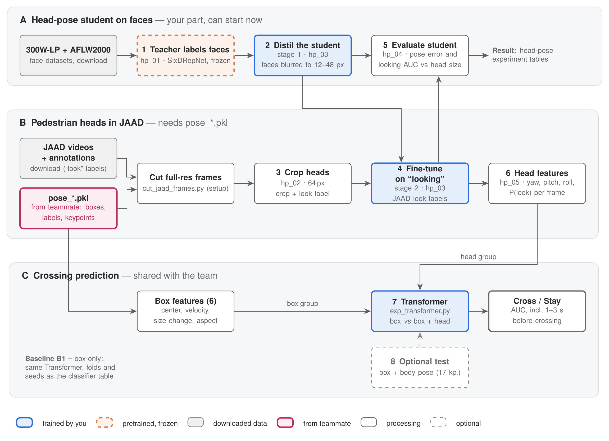

# Head orientation + cue-group Transformer

This adds two things to the existing pipeline (`pose_extract.py` → `exp_classifiers.py`):

1. **A head-pose student** trained from scratch by distilling SixDRepNet, built for tiny, blurry pedestrian heads, plus a "looking at the car" output.
2. **A box + head-pose Transformer** (`exp_transformer.py`). It is the same Transformer as in `exp_classifiers.py`, extended so it can read the head features next to the box features.

**What is compared**

| Test | Inputs to the crossing model | How to run |
|---|---|---|
| Baseline B1 | box (6 features) | default |
| **Main test** | box + head pose (6 + 6 features) | default |
| Separate test (optional) | box + body pose (6 + 85 features, the 17 keypoints) | `--sets bbox+pose`, or `BODY_TEST=1` in `run_all.sh` |

The 17 body keypoints are **not** an input to the main model. By default, `hp_02` uses the nose, eye and ear positions already stored in `pose_*.pkl` only to find *where* the head is, so the crop is centred on it. With `--head_from box` (or `HEAD_FROM=box` in `run_all.sh`) the head is placed at the top of the pedestrian box instead and no keypoints are used anywhere; crops are then less precise (e.g. when the person bends or the box is loose).



```
pose_{split}.pkl (boxes + YOLO26 keypoints, from pose_extract.py)
   │
   ├─ hp_02  head box from face keypoints → crop from the JAAD frame → 64x64 head crop
   │                                       → JAAD 'look' label, teacher angles
   │
300W-LP / AFLW2000 faces
   └─ hp_01  clean crop → SixDRepNet teacher (frozen) → teacher rotation = distillation target
                 │
              hp_03  stage 1: degrade clean faces to 12–48 px, student learns teacher's rotation
                     stage 2: fine-tune on JAAD heads with 'look' labels
                 │
              hp_04  evaluation: pose error vs head size; 'looking' AUC vs head size
              hp_05  per-frame head features → head_{split}.pkl
                 │
exp_transformer.py   box (B1) vs box + head pose, same CV as exp_classifiers.py
```

## New files

| File | What it does |
|---|---|
| `headpose/config.py` | Paths (same JAAD layout as `run_pipeline.py`) and constants |
| `headpose/teacher.py` | Loads the SixDRepNet release checkpoint safely (`weights_only=True`) and runs it |
| `headpose/student.py` | Student: MobileNetV3-Small from random init, 64x64 input, 6D rotation + look heads (1.1 M params vs 26.8 M for the teacher) |
| `headpose/degrade.py` | Turns clear faces into JAAD-like heads: shrink to 12–48 px, aspect squash from the 640x640 stretch, blur, motion blur, light, noise, CLAHE, JPEG |
| `headpose/head_crop.py` | Head box from nose / eyes / ears (fallback: shoulders, then top of the box), crop from stored or full-res frames |
| `headpose/jaad_look.py` | Per-frame `look` labels from `data/JAAD/annotations/video_XXXX.xml` |
| `headpose/rotation.py` | 6D→matrix, matrix→Euler, geodesic loss, flip (all SixDRepNet conventions) |
| `hp_01_label_faces.py` … `hp_05_head_features.py` | The five steps above |
| `exp_transformer.py` | Cue-group Transformer experiment |
| `setup_aws.sh`, `run_all.sh` | One-time setup, then the whole pipeline in order with input checks and resume |
| `cut_jaad_frames.py` | Cuts the needed JAAD frames at full resolution from the original clips |

## Setup

```bash
pip install -r requirements.txt          # adds scipy, tqdm; torch >= 2.5 for safe checkpoint loading
```

Data:

| What | Where it goes | Source |
|---|---|---|
| SixDRepNet RepVGG-A2 weights | `data/sixdrepnet/best_a2.pt` | `setup_aws.sh` downloads it (GitHub release v1) |
| 300W-LP (training faces) | `data/HPE/300W_LP/…` (jpg + mat pairs) | `GET_FACES=1 bash setup_aws.sh` (Google Drive id `0B7OEHD3T4eCkVGs0TkhUWFN6N1k`, 2.8 GB) |
| AFLW2000-3D (test faces) | `data/HPE/AFLW2000/…` | `GET_FACES=1 bash setup_aws.sh` (http://www.cbsr.ia.ac.cn/users/xiangyuzhu/projects/3DDFA/Database/AFLW2000-3D.zip, 87 MB) |

Both face downloads use the same URLs and SHA-256 checksums as TensorFlow Datasets (`aflw2k3d`, `the300w_lp` builders), but keep the raw jpg + mat files. The TFDS-built versions can't be used directly: the AFLW2000-3D builder keeps only the image and 3D landmarks and drops the head-pose angles (`Pose_Para`) that the evaluation needs, and both store TFRecords instead of the jpg + mat layout the scripts read.
| JAAD annotations (boxes + `look`) | `data/JAAD/annotations/video_XXXX.xml` | `annotations/` folder of github.com/ykotseruba/JAAD (`GET_JAAD=1 bash setup_aws.sh` copies it) |
| `outputs_pose/pose_{split}.pkl` | as produced by `pose_extract.py` | your teammate (boxes, labels, decision points, keypoints) |
| JAAD frames | stored 640x640 frames in `data/vehic-ped-intuition/images/{split}/`, **or** full-resolution frames cut with `cut_jaad_frames.py` | your teammate, or the JAAD clips (`download_clips.sh` in the JAAD repo, ~3 GB) |

**Full-resolution frames (recommended).** The stored frames are 640x640, stretched from 1920x1080, so heads keep only about 1/3 of their width. `cut_jaad_frames.py` reads the JAAD clips and saves exactly the frames listed in `pose_*.pkl` at 1920x1080, with the same names, so nothing else changes:

```bash
python cut_jaad_frames.py --clips data/JAAD_repo/JAAD_clips      # -> data/jaad_fullres/images/{split}/
FRAMES_DIR=data/jaad_fullres bash run_all.sh
```

The boxes and keypoints in the `.pkl` files stay valid: the crop code converts them to whatever resolution the frames have. Frame numbers are read sequentially from the video, so they match the JAAD annotation numbering exactly.

**PIE** (github.com/aras62/PIE) is not used yet. Its clips are about 74 GB, and boxes and keypoints would first have to be produced for it, because `pose_extract.py` reads the JAAD format. Its annotations do include the same `look` label, so the head-pose student can be reused on it later.

A GPU is strongly recommended for steps 1–3 (the teacher is a 26.8 M-parameter network at 224x224).

## Run

On AWS (or any Linux GPU machine), from the repo root:

```bash
bash setup_aws.sh                         # packages, teacher weights, folders; lists any missing inputs
GET_FACES=1 bash setup_aws.sh             # 300W-LP + AFLW2000 (only the head-pose part needs them)
bash run_all.sh --faces-only              # part A: teacher labels, student stage 1, face evaluation - no pose_*.pkl needed
QUICK=1 bash run_all.sh                   # 2-3 minute test of the whole chain (results meaningless)
nohup bash run_all.sh > logs/run_all.log 2>&1 &   # the real run; survives a dropped SSH connection
tail -f logs/run_all.log                  # watch progress
```

`run_all.sh` checks the inputs first and says exactly what is missing. Each step writes `logs/stepN.log`. If the run stops, starting it again skips the steps that already finished. Options: `--from N`, `FORCE=1`, `WORKERS=4`, `LIMIT=60000`, `FRAMES_DIR=...` (see the top of the script).

Or step by step:

```bash
python hp_01_label_faces.py                       # add --limit 60000 if RAM is tight (300W-LP has ~122k faces)
python hp_02_extract_jaad_heads.py                # add --frames_dir <full-res frames> if you have them (see below)
python hp_03_train_student.py --stage 1           # 40 epochs; add --jaad_pseudo to also use large JAAD heads
python hp_03_train_student.py --stage 2           # 15 epochs, 'look' fine-tune
python hp_04_eval_heads.py                        # Experiment 2 tables
python hp_05_head_features.py                     # head_{split}.pkl
python exp_transformer.py                         # main test: box vs box + head, 5-fold CV, 3 seeds
python exp_transformer.py --sets bbox+pose        # optional separate test: box + body pose
```

## Outputs to look at

| File | Use in the report |
|---|---|
| `outputs_head/faces_300W_LP.npz` log line | Teacher MAE on clean faces (should be ~4 deg; if not, the crop or data layout is wrong) |
| `outputs_head/eval_aflw_by_size.csv` | Pose error (deg) vs head size, teacher vs student: shows where the teacher breaks and the student holds |
| `outputs_head/eval_jaad_look.csv` | 'Looking' AUC on JAAD test by head size: teacher yaw rule vs student yaw rule vs student look head |
| `outputs_pose/results_transformer_cv_bbox_bbox+head.csv` | Main test: box (B1) vs box + head pose; `auc_tte_*` columns = AUC at 0–1 s, 1–2 s, 2–3 s, 3 s+ before the decision point |
| `outputs_pose/results_transformer_cv_bbox+pose.csv` | Optional separate test: box + body pose |

`exp_transformer.py` prints a mean ± std table at the end.

## Design notes

**Same Transformer as before.** Each cue group has its own linear input projection, and the projections are summed into the 64-d frame token. With only the box group, this is mathematically the original model, and parameters are created in the same order. On a test set, `--sets bbox` gives predictions identical (max difference 0.0) to `exp_classifiers.train_deep('Transformer')` for the same seed, so the B1 row reproduces the earlier table. Optimiser, epochs, early stopping, windows, scaler, folds and metrics are all reused from `exp_classifiers.py`.

**Modality dropout** (`--mod_drop`, default 0.15). During training, the head group's projection is zeroed per sample, so the model copes when the head is missing (turned away, too small). The box group is never dropped.

**Head features per frame** (6): yaw, pitch, roll (÷90), P(looking), yaw change since the previous sample, and a "head usable" flag. A head is usable if it is at least 4 stored pixels and, with keypoint placement, its box came from face keypoints. Otherwise the angles are 0 and the flag is 0.

**Distillation targets.** The student learns the teacher's rotation on the *clean* face while seeing the *degraded* face. 300W-LP also has ground truth; add it with `--gt_weight 1.0` if wanted. By default it is only used for evaluation (AFLW2000), so the student is purely distilled.

**Tiny heads.** The stored frames are 640x640, stretched from 1920x1080, so heads are about 1/3 of their original width. With full-resolution frames extracted from the JAAD clips (same file names, `images/{split}/video_XXXX_fYYYY.jpg`), pass `--frames_dir` to `hp_02`. The crop code handles any 16:9 resolution, and many more heads become large enough for teacher pseudo-labels (`TEACHER_MIN_PX = 32` stored pixels).

**Quick sanity check of the teacher** (9 real faces from the SixDRepNet demo GIF, not a result): on clean ~200 px crops it gives sensible angles. After degrading the same faces to 16–32 px, its prediction moves 44–65 deg from its clean prediction. This is the gap the student is meant to close.

## Caveat: CV leakage from stage 2

Stage 2 fine-tunes on JAAD **train-split** `look` labels. `exp_transformer.py` 5-fold CV mixes all splits, so some test folds contain videos whose head crops the student saw (with look labels, not crossing labels). For a strictly clean comparison, either:

- build features from the stage-1 checkpoint (`python hp_05_head_features.py --ckpt outputs_head/student_stage1.pt`), which only saw 300W-LP; then `h_look` is constant and only the angles are used; or
- report `python exp_transformer.py --official` (train / val / test split) for the stage-2 features.
